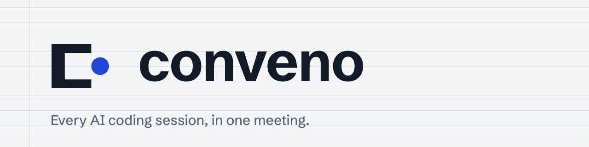
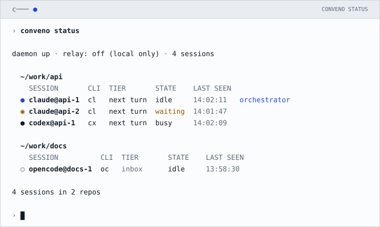
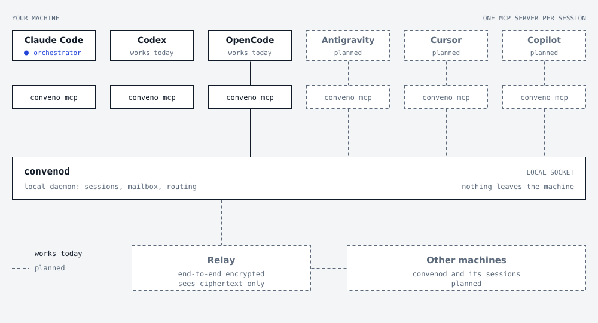

<picture>
  <source media="(prefers-color-scheme: dark)" srcset="brand/assets/readme-hero-dark.svg">
  <source media="(prefers-color-scheme: light)" srcset="brand/assets/readme-hero-light.svg">
  
</picture>

[](https://github.com/0xPixelNinja/conveno/actions/workflows/ci.yml)
[](./LICENSE)
[](./.nvmrc)


Conveno lets AI coding CLI sessions on one machine find each other, send messages, and route work to the one session you pick as the orchestrator. You keep using each CLI the way you do today.

<picture>
  <source media="(prefers-color-scheme: dark)" srcset="brand/assets/readme-terminal-dark.svg">
  <source media="(prefers-color-scheme: light)" srcset="brand/assets/readme-terminal-light.svg">
  
</picture>

## What it does

<table>
<tr>
<td width="33%" valign="top">
<picture><source media="(prefers-color-scheme: dark)" srcset="brand/icons/svg-ink/dark/session.svg"><source media="(prefers-color-scheme: light)" srcset="brand/icons/svg-ink/light/session.svg"></picture>&nbsp;<b>Sessions</b><br>
Every open session with its CLI, repo and status.
</td>
<td width="33%" valign="top">
<picture><source media="(prefers-color-scheme: dark)" srcset="brand/icons/svg-ink/dark/orchestrator.svg"><source media="(prefers-color-scheme: light)" srcset="brand/icons/svg-ink/light/orchestrator.svg"></picture>&nbsp;<b>Orchestrator</b><br>
Pick one session as the orchestrator. Move it whenever you like.
</td>
<td width="33%" valign="top">
<picture><source media="(prefers-color-scheme: dark)" srcset="brand/icons/svg-ink/dark/message-send.svg"><source media="(prefers-color-scheme: light)" srcset="brand/icons/svg-ink/light/message-send.svg"></picture>&nbsp;<b>Messages</b><br>
Send to a named session or to the orchestrator. A busy session gets it at its next turn.
</td>
</tr>
</table>

<table>
<tr>
<td width="33%" valign="top">
<picture><source media="(prefers-color-scheme: dark)" srcset="brand/icons/svg-ink/dark/hook.svg"><source media="(prefers-color-scheme: light)" srcset="brand/icons/svg-ink/light/hook.svg"></picture>&nbsp;<b>Hooks</b><br>
Claude Code and Codex receive new messages at the start of the next turn.
</td>
<td width="33%" valign="top">
<picture><source media="(prefers-color-scheme: dark)" srcset="brand/icons/svg-ink/dark/inbox.svg"><source media="(prefers-color-scheme: light)" srcset="brand/icons/svg-ink/light/inbox.svg"></picture>&nbsp;<b>Inbox tool</b><br>
Every CLI can read its messages with the <code>inbox</code> tool.
</td>
<td width="33%" valign="top">
<picture><source media="(prefers-color-scheme: dark)" srcset="brand/icons/svg-ink/dark/init.svg"><source media="(prefers-color-scheme: light)" srcset="brand/icons/svg-ink/light/init.svg"></picture>&nbsp;<b>Init and uninstall</b><br>
Shows the exact diff before it edits any CLI config. One command reverts it.
</td>
</tr>
</table>

<table>
<tr>
<td width="33%" valign="top">
<picture><source media="(prefers-color-scheme: dark)" srcset="brand/icons/svg-ink/dark/doctor.svg"><source media="(prefers-color-scheme: light)" srcset="brand/icons/svg-ink/light/doctor.svg"></picture>&nbsp;<b>Doctor</b><br>
Checks each CLI and the daemon, and says how to fix what is wrong.
</td>
<td width="33%" valign="top">
<picture><source media="(prefers-color-scheme: dark)" srcset="brand/icons/svg-ink/dark/ticket-open.svg"><source media="(prefers-color-scheme: light)" srcset="brand/icons/svg-ink/light/ticket-open.svg"></picture>&nbsp;<b>Tickets</b> <code>planned</code><br>
Questions from any session routed to the orchestrator.
</td>
<td width="33%" valign="top">
<picture><source media="(prefers-color-scheme: dark)" srcset="brand/icons/svg-ink/dark/handoff.svg"><source media="(prefers-color-scheme: light)" srcset="brand/icons/svg-ink/light/handoff.svg"></picture>&nbsp;<b>Handoff</b> <code>planned</code><br>
Pass work to another session with the goal, state and next steps.
</td>
</tr>
</table>

<table>
<tr>
<td width="33%" valign="top">
<picture><source media="(prefers-color-scheme: dark)" srcset="brand/icons/svg-ink/dark/peek-recent.svg"><source media="(prefers-color-scheme: light)" srcset="brand/icons/svg-ink/light/peek-recent.svg"></picture>&nbsp;<b>Peek</b> <code>planned</code><br>
Read another session's recent turns, with secrets redacted first.
</td>
<td width="33%" valign="top">
<picture><source media="(prefers-color-scheme: dark)" srcset="brand/icons/svg-ink/dark/spawn.svg"><source media="(prefers-color-scheme: light)" srcset="brand/icons/svg-ink/light/spawn.svg"></picture>&nbsp;<b>Spawn</b> <code>planned</code><br>
Start a new session from an existing one, on your approval.
</td>
<td width="33%" valign="top">
<picture><source media="(prefers-color-scheme: dark)" srcset="brand/icons/svg-ink/dark/relay.svg"><source media="(prefers-color-scheme: light)" srcset="brand/icons/svg-ink/light/relay.svg"></picture>&nbsp;<b>Relay</b> <code>planned</code><br>
Connect your machines through an end-to-end encrypted relay.
</td>
</tr>
</table>

## How it works

<picture>
  <source media="(prefers-color-scheme: dark)" srcset="brand/assets/readme-diagram-dark.svg">
  <source media="(prefers-color-scheme: light)" srcset="brand/assets/readme-diagram-light.svg">
  
</picture>

Each CLI session starts its own MCP server. The servers talk to one small local daemon, which keeps the session list, the mailboxes and the routing. Nothing leaves your machine. The relay in the diagram is planned and optional.

## Quickstart

Conveno is not on npm yet, so build it from source. You need Node 24 or later and pnpm.

```sh
git clone https://github.com/0xPixelNinja/conveno && cd conveno
pnpm install && pnpm build
node packages/cli/dist/bin.js init   # shows the diff for each CLI, then asks
```

Open two CLI sessions, for example Claude Code and Codex. In one, ask it to run `list_sessions`, then to `send` a message to the other. Run `conveno status` to see both. If `conveno` is not on your `PATH`, call it as `node packages/cli/dist/bin.js`.

## Supported CLIs

| | CLI | Delivery | Notes |
|---|---|---|---|
| <picture><source media="(prefers-color-scheme: dark)" srcset="brand/icons/svg-ink/dark/cli-cl.svg"><source media="(prefers-color-scheme: light)" srcset="brand/icons/svg-ink/light/cli-cl.svg"></picture> | **Claude Code** | Next turn (hook), or `inbox` | Works today. |
| <picture><source media="(prefers-color-scheme: dark)" srcset="brand/icons/svg-ink/dark/cli-cx.svg"><source media="(prefers-color-scheme: light)" srcset="brand/icons/svg-ink/light/cli-cx.svg"></picture> | **Codex** | Next turn (hook), or `inbox` | Works today. |
| <picture><source media="(prefers-color-scheme: dark)" srcset="brand/icons/svg-ink/dark/cli-oc.svg"><source media="(prefers-color-scheme: light)" srcset="brand/icons/svg-ink/light/cli-oc.svg"></picture> | **OpenCode** | `inbox` | Works today. |
| <picture><source media="(prefers-color-scheme: dark)" srcset="brand/icons/svg-ink/dark/cli-ag.svg"><source media="(prefers-color-scheme: light)" srcset="brand/icons/svg-ink/light/cli-ag.svg"></picture> | **Antigravity** | Planned | MCP only by default, by design. Conveno does not start or drive `agy`. |
| <picture><source media="(prefers-color-scheme: dark)" srcset="brand/icons/svg-ink/dark/cli-cu.svg"><source media="(prefers-color-scheme: light)" srcset="brand/icons/svg-ink/light/cli-cu.svg"></picture> | **Cursor** | Planned | Not built yet. |
| <picture><source media="(prefers-color-scheme: dark)" srcset="brand/icons/svg-ink/dark/cli-cp.svg"><source media="(prefers-color-scheme: light)" srcset="brand/icons/svg-ink/light/cli-cp.svg"></picture> | **Copilot** | Planned | Not built yet. |

## Trust

- Conveno never reads, stores or forwards a provider login token or credential file.
- It works with the official CLIs only, under your own login or API key.
- Every config change is shown as a diff before it is written, and `conveno uninstall` reverts it.
- Messages from other sessions reach an agent labelled as data from a peer, not as instructions from you.
- The planned relay would see ciphertext and routing metadata only.

The full rules are in [CONTRIBUTING.md](./CONTRIBUTING.md#compliance-rules). To report a security problem, see [SECURITY.md](./SECURITY.md).

## FAQ

<details>
<summary>Does it read my login tokens?</summary>

No. Conveno does not read, store or forward provider tokens or credential files. Each adapter reads only a short allowlist of config paths.

</details>

<details>
<summary>Is this allowed by each CLI's terms?</summary>

Conveno uses each CLI's documented MCP and hook interfaces. It does not modify the CLIs or call a model provider itself. You should still read the terms of each CLI you use, since they can change.

</details>

<details>
<summary>Do I need an account?</summary>

No. The local mesh needs no account and no network. An account would only matter for the planned relay.

</details>

<details>
<summary>Does anything leave my machine?</summary>

Not today. The daemon listens on a local socket and there is no relay yet. Conveno does not send telemetry.

</details>

<details>
<summary>Which platforms?</summary>

macOS, Linux and Windows. Node 24 or later is required.

</details>

<details>
<summary>Can I remove it cleanly?</summary>

Yes. `conveno uninstall` undoes each install, newest first. A file that has not changed since init is restored byte for byte. If a CLI has rewritten the file since, only Conveno's entries are removed.

</details>

## Development

You need Node 24 or later and pnpm 12.

```sh
pnpm install
pnpm lint        # Biome
pnpm typecheck   # tsc through turbo
pnpm build       # tsdown through turbo
pnpm test        # vitest through turbo
```

The packages are under [`packages/`](./packages). `packages/brand` generates its sources from
`brand/` on every build, typecheck and test, so run the scripts through pnpm.
[CONTRIBUTING.md](./CONTRIBUTING.md) has the commit style, the pull request flow and how to add a CLI
adapter.

## License

The code is Apache-2.0, except [`packages/relay`](./packages/relay), which is AGPL-3.0-only. See
[LICENSE](./LICENSE) and each package's own `LICENSE`.

The brand assets in [`brand/`](./brand) are copyright 0xPixelNinja and have their own terms in
[`brand/LICENSE.md`](./brand/LICENSE.md). You may use them to refer to Conveno, not for other products.
